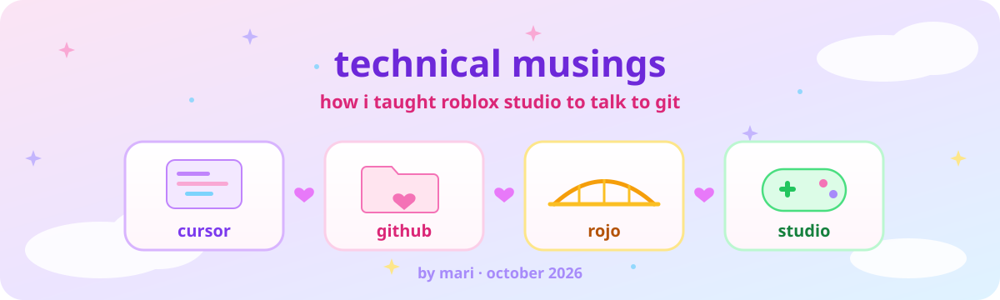
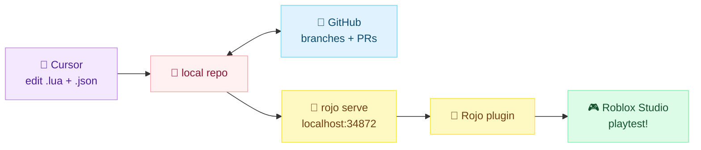

<p align="center">
  
</p>

<h1 align="center">✨ how i taught roblox studio to talk to git ✨</h1>
<p align="center"><i>a cursor ♡ rojo ♡ github sync story, with bugs, fixes, and lots of pastel</i></p>
<p align="center">
  🌸 <b>Mari</b> · October 2026 · ~7 min read 🌸
</p>

---

## 🍓 the problem (╥﹏╥)

I'm building **StarCove**, a cozy Roblox life-sim with farming, fashion contests, dream rooms, fishing, and a little in-game phone called StarLink.

But Roblox Studio has one big catch for anyone used to normal software dev:

> everything lives inside **one binary place file** (`.rbxl`).

That means:

- 🚫 no readable diffs
- 🚫 no real branches or pull requests
- 🚫 no editing in a modern editor
- 🚫 no AI pair programmer reading my code

I write C# and AWS backends at my day job. I wanted that same workflow for my game: real files, real git history, real PRs. So I built it. ˖✧

---

## 🧁 what i built

Three tools, each with one job:

| tool | its job | vibe |
|------|---------|------|
| 💜 **Cursor** | where I write code, with an AI pair programmer | the brain |
| 🐙 **GitHub** | source of truth: branches, PRs, history | the diary |
| 🌉 **Rojo** | live-syncs files from disk into Studio | the bridge |
| 🎮 **Roblox Studio** | playtesting only, code doesn't live here anymore | the stage |



The big mindset shift: **Studio stops being the place where code lives.** It becomes the place where code *runs*. ♡

---

## 🎀 how it works

### the map: `default.project.json`

Rojo reads one file that says "this folder on disk becomes this service in Roblox":

```json
{
  "name": "StarCove",
  "tree": {
    "$className": "DataModel",
    "ReplicatedStorage":   { "$path": "ReplicatedStorage" },
    "ServerScriptService": { "$path": "ServerScriptService" },
    "StarterGui":          { "$path": "StarterGui" },
    "StarterPlayer": {
      "StarterPlayerScripts": { "$path": "StarterPlayerScripts" }
    }
  }
}
```

So `ServerScriptService/Services/QuestService.lua` on my laptop shows up in Studio as a ModuleScript in exactly the right spot. ✿

### the file naming rules

Rojo figures out *what kind* of thing to make from the file name:

| file | becomes |
|------|---------|
| `Main.server.lua` | 🖥️ Script (server) |
| `HUDClient.client.lua` | 📱 LocalScript (client) |
| `QuestService.lua` | 📦 ModuleScript |
| `init.meta.json` | 🎨 properties for a GUI or folder (size, position, colors) |
| `BuyItem.model.json` | ✨ a standalone instance, like a RemoteEvent |

### keeping git clean

```gitignore
*.rbxl
*.rbxlx
.DS_Store
```

The binary place file never touches git. Only readable source does. ദ്ദി(˵ •̀ ᴗ - ˵ ) ✧

---

## 🌷 the interesting part: sharing Workspace with Studio

Here's a real tradeoff I had to think through.

Code is easy to keep in files. But **maps** are not. I place props, lamps, benches, and planters by hand in Studio, because dragging things around visually is the whole point.

My first setup told Rojo to own *all* of Workspace:

```json
"Workspace": { "$path": "Workspace" }
```

And Rojo did exactly what I asked. On sync, it looked at Workspace, saw a bunch of things that weren't in my files, and **deleted them**. My hand-built map, gone. (｡•́︿•̀｡)

The fix was to let Rojo manage *only* the pieces that are code-driven, and politely ignore everything else:

```json
"Workspace": {
  "$className": "Workspace",
  "$ignoreUnknownInstances": true,
  "FarmPlot": {
    "$path": "Workspace/FarmPlot",
    "$ignoreUnknownInstances": true
  },
  "FashionContest": {
    "$path": "Workspace/FashionContest",
    "$ignoreUnknownInstances": true
  }
}
```

`$ignoreUnknownInstances: true` basically means *"if you don't recognize it, leave it alone."* 🫶

Now I get both worlds:

- 🧸 **Studio owns** the hand-built map
- 📁 **git owns** the systems that need versioning (FarmPlot, FashionContest, GeekOutDemo)

I think this is the most important idea in the whole setup: **decide on purpose which tool owns which part of the world.**

---

## 🐛 what broke (and how i fixed it)

All three of these happened on the same day. Classic. ٩(×̯×)۶

### bug 1: my map kept disappearing

- **symptom:** syncing deleted props I'd placed in Studio
- **cause:** Rojo owned all of Workspace
- **fix:** partial ownership with `$ignoreUnknownInstances` (see above!)

### bug 2: RemoteEvents just... didn't exist

- **symptom:** shop and housing code errored because RemoteEvents like `PlaceFurniture` and `VisitRoom` were missing in Studio
- **cause:** I'd made them as `.meta.json` files. A meta file only *adds properties* to something that already exists. It doesn't create anything on its own.
- **fix:** rename them to `.model.json`, which actually defines a new instance

```
Remotes/PlaceFurniture.meta.json   ❌
Remotes/PlaceFurniture.model.json  ✅
```

### bug 3: my GUIs looked cursed

- **symptom:** corners, padding, and layout were off across the Fashion, Housing, and StarLink panels
- **cause:** I wrote `UDim` values as plain arrays, so Rojo couldn't tell what type they were
- **fix:** use Rojo's explicit typed format

```diff
- "CornerRadius": [[0, 8]]
+ "CornerRadius": { "UDim": [0, 8] }
```

And for positions and sizes:

```json
"Position": { "UDim2": [[0, 12], [0, 80]] }
```

That fix touched about 30 files, so I wrote a small shell script (`scripts/fix_meta.sh`) to regenerate the meta files in the correct shape instead of hand-editing each one. 🧹✨

---

## 🤖 working with an AI pair programmer

Cursor isn't just my editor, it's a collaborator. AI-assisted commits carry a trailer so authorship stays honest:

```
Co-authored-by: Cursor <cursoragent@cursor.com>
```

Because my code now lives in normal files, the AI can actually *read the whole project*. That unlocked things that would have been impossible inside Studio:

- 🧪 a **94-test automated suite** for my inventory, economy, currency, needs, and persistence systems, including 15 integration tests, all runnable from Studio with:

  ```lua
  require(game.ServerScriptService.Tests.TestRunner).RunAll()
  ```

- 🎪 a full set of demo prototypes in one go: needs, the StarLink phone, NPC dialogue with a relationship meter, shop and inventory, and a quest board

But the AI didn't replace my judgment. I still:

- 🎮 playtest everything in Studio and watch the Output window
- 👀 review every PR
- 🧭 decide what gets merged and when

---

## 💭 what i'd do differently

Being honest here, because musings should be ♡

- **the place file still isn't in git.** Anyone joining the project needs it sent separately. I'd like to move more of the map into Rojo-managed models over time.
- **branches drifted.** It got *so easy* to spin up new work that I ended up with five diverged branches. AI speeds you up, and it also makes it easy to create more work than you've merged. Merge early, merge often!
- **manual test checklists matter too.** 94 automated tests is great, but some things (does the GUI *look* right?) still need human eyes.

---

## 🌟 takeaways

1. 🎮 **Studio is the stage, not the source.** Keep code in real files.
2. 🌉 **decide who owns what.** Rojo owns systems, Studio owns the hand-built world.
3. 🤖 **real files unlock real AI help.** Tests, prototypes, and PRs all became possible once my code was readable.

Thanks for reading! If you're a Roblox dev who wants git, real PRs, and an AI pair programmer, I hope this saves you a few disappearing maps. (っ˘ω˘ς ) ✨

<p align="center">⋆｡°✩ 🌸 ✩°｡⋆</p>
